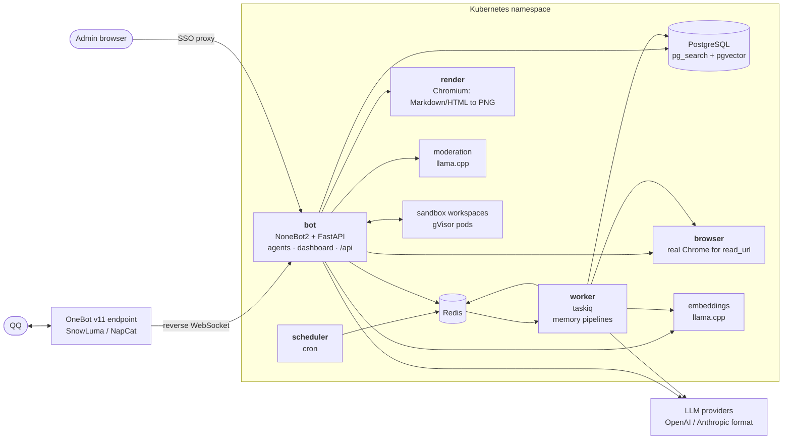
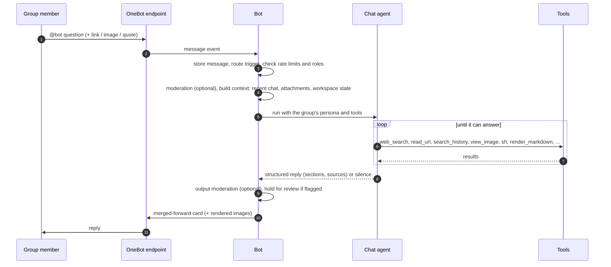

<div align="center">

# YggdrasilBot

**An LLM agent that lives in QQ group chats, and remembers them.**

It answers when it is asked, checks its facts with real tools, reads what people post (links, files, images,
chat-log forwards), keeps a searchable long-term memory of each group, and can do actual work in a sandboxed
Linux workspace. All of it is configured live from a web dashboard.

[](https://github.com/FYWinds/YggdrasilBot/actions/workflows/ci.yaml)


[](https://github.com/astral-sh/uv)
[](https://github.com/astral-sh/ruff)

[Features](#features) · [Architecture](#architecture) · [Quick start](#quick-start-local-development) · [Deployment](deploy/README.md) · [Development](#development)

</div>

---

## Features

### Conversation

| | |
|---|---|
| **Answers when addressed** | Triggers on an @mention, a reply to the bot, or its name in the text. Trigger rules (keywords, regex, scope, roles, cooldowns, priorities) are data, edited and tested in the dashboard. Other bots never trigger it: accounts tagged `[bot]`, official QQ bots and an ignore list. |
| **Checks before it answers** | The chat agent searches the web, reads the sources, and looks up the group's own history before it writes. Replies are QQ merged-forward cards with sections and cited sources. The agent may also decide a message wasn't meant for it and stay silent. |
| **TL;DR** | Reply `tldr` / `太长不看` / `总结一下` to a message, link, file or forwarded chat log and get a summary of it. Asking again for the same target within a few minutes gets a reaction instead of a second summary. |
| **Persona and prompts** | Name, voice, reply style, quoting and status reactions per group; every prompt is a Jinja template you can override. |
| **Operations by chat** | Superusers can ask the ops agent in private chat to inspect or change configuration in natural language, and approve or reject held replies with `通过` / `拒绝` / `改`. |

### Understanding what people post

| Input | How |
|---|---|
| Links | `read_url`: fast HTTP extraction with a browser TLS fingerprint (curl_cffi) and site adapters (bilibili and YouTube videos with their subtitles as a timed transcript, GitHub repos, folders, files, issues, pull requests and profiles through the public API, Tangled code, Hacker News, Telegram, X, Statuspage incidents, Ubuntu CVEs, Hugging Face model and dataset cards, MSN articles, ...), then a real Chrome for JavaScript-only or blocked pages, then (optionally) the DeepSeek Fetch API for pages neither can read from your IP, such as many Chinese platforms. A link's `#fragment` starts the text at that section, and JSON API responses are compacted (no ids, API cross-links or signatures). Login walls, captchas, cookie-consent walls and anti-bot block pages come back as a clear error, not a hallucinated summary. |
| X | `read_x` reads a post with its full text, quoted post, poll, community note, conversation and images through FxTwitter, falling back to the official X API. `search_x` searches X News stories (Grok-written summaries) and recent posts through the official X API, which is pay per use; its bearer token is stored as a search provider. |
| Files | PDF, Office documents, text and code via markitdown and pypdfium2. Scanned PDFs are sent to vision models as page images. |
| Images | Vision models see the original; otherwise a vision route describes and transcribes it (OCR fallback). Animated GIF/WebP stickers become one sheet of up to 16 frames, sampled where the picture changes (every 0.1–0.3 s), because models only read an animation's first frame. Images from earlier in the chat can be opened by message id, and expired QQ image links are re-signed transparently. |
| Chat-log forwards | Expanded recursively, nested forwards included. |
| Cards, replies, mentions | Normalized into readable text with stable `名字(QQ号)` labels. |

### Long-term memory

The worker turns the raw message stream into memory the agent can search:

- **Topics**: messages are segmented into topics with titles, summaries, keywords and participants. Topics close when a conversation goes idle; recalled messages trigger a recompute.
- **Glossary**: group slang and in-jokes are mined nightly and defined from real examples.
- **Profiles**: per-member interests, recurring themes and facts, built from closed topics. The `get_profile` tool shows the ten highest-weighted facts.
- **Curation**: an hourly job rates closed topics and profile facts 1–5 with the topic and profile routes, weights them by size, supporting messages and age, merges duplicate facts, keeps at most `memory.facts_per_user` active facts per member, and archives what falls below `memory.topic_archive_below_weight` / `memory.fact_archive_below_importance`. Archived items leave search, digests, profile updates and prompts but stay in the console, where they can be restored.
- **Daily digests**: one summary of each day in a fixed plain-text format (overview, then numbered events with message counts and participants).
- **Hybrid search**: BM25 with the jieba tokenizer (ParadeDB `pg_search`) plus pgvector embeddings, fused with RRF, over messages, topics, glossary and digests.
- **Stickers**: custom stickers seen in chat are saved on first sight (QQ image links expire quickly), counted per group, and described, tagged and moderation-flagged by a vision model (`sticker` route). Flagged stickers stay enabled unless `moderation.disable_unsafe_stickers` is on.
- **Privacy**: members can say `不要记我` / `记得我` / `忘记我` (with an @mention) to opt out, opt back in, or delete what was stored about them.

### Doing real work: sandbox workspaces

With the optional sandbox, the chat model gets persistent Linux workspaces, one per topic. Each is its own
gVisor pod, claimed from a warm pool.

- `sh` runs shell scripts; `py` is a persistent IPython kernel with a scriptable headless Chromium.
- `background` runs long commands, and `delegate` hands a multi-step task to an inner coding agent. Both report back to the group when they finish.
- Agents inside a workspace reach models through the bot's LLM relay, with a short-lived per-job token and budget instead of a provider key.
- Services started in a workspace can be published on a public link, on a domain reserved for untrusted content.

### Rendering

`render_markdown`, `render_mermaid` and `render_html` turn tables, diagrams, math and code into crisp images
(GitHub-style Markdown with Shiki and KaTeX, every Mermaid diagram type, sanitized inline HTML) via a warm
Chromium page pool, typically in well under a second.

### Safety and operations

- **Moderation**: an optional Qwen3Guard classifier checks requests and replies. Suspicious replies are held for a superuser's review instead of being sent.
- **Guardrails in code**: per-user and per-group concurrency limits with bounded queues, a daily token budget per group, usage limits per run, SSRF-guarded fetching, untrusted content fenced in prompts, and action tools only handed to a run once the speaker is allowed to use them.
- **Dashboard**: providers and model routes, groups and per-group settings, triggers (with a live tester), versioned prompts, stickers, search providers, memory browser, review queue, sandbox workspaces and a searchable, permanent history of background jobs with their full event logs, and invocation history with tool calls, token usage and latency. Every configuration change is audited.
- **Observability**: OpenTelemetry traces, metrics and logs, with invocations linked to their traces.
- **Any model**: OpenAI- and Anthropic-compatible providers, a model route per task (chat, tldr, vision, memory, moderation, embeddings, ...) with fallbacks; model capabilities come from models.dev.

## Architecture



One image serves the bot, worker, scheduler and migration roles. The bot owns the single OneBot connection;
heavy work runs in the worker, and anything the worker wants to say goes back through the bot.

<details>
<summary><b>What happens when someone @-mentions the bot</b></summary>



</details>

<details>
<summary><b>Agent tools</b></summary>

| Group | Tools |
|---|---|
| Web | `web_search`, `read_url`, `search_x`, `read_x` |
| Attachments | `view_image`, `read_file`, `expand_forward` |
| Group memory | `search_history`, `get_messages_around`, `recent_chat`, `lookup_glossary`, `get_profile` |
| Rendering | `render_markdown`, `render_mermaid`, `render_html` |
| Workspaces | `open_workspace`, `sh`, `py`, `sandbox_put`, `reset_workspace` |
| Background jobs | `background`, `delegate`, `jobs`, `cancel_job` |
| Actions (granted per run) | `recall_message`, ... |

</details>

## Tech stack

| Layer | Choice |
|---|---|
| Runtime | Python 3.13, uv, NoneBot2 (FastAPI driver) + OneBot v11 adapter, Alconna |
| Agents | pydantic-ai (OpenAI and Anthropic model classes), structured outputs, usage limits |
| Storage | PostgreSQL 18 with ParadeDB (`pg_search` BM25 + jieba, `pgvector`), SQLAlchemy 2 async, Alembic |
| Background | taskiq + Redis |
| Dashboard | React 19, Vite, shadcn/ui, TanStack Query/Router, client generated from the OpenAPI schema |
| Render service | Node + TypeScript, Playwright Chromium, markdown-it, Shiki, KaTeX, Mermaid, DOMPurify |
| Browser service | Google Chrome (headed, Xvfb), patchright, nodriver, curl_cffi for the plain-HTTP tier |
| Sandbox | kubernetes-sigs/agent-sandbox, gVisor, sandboxd (REST + gRPC), IPython |
| Local inference | llama.cpp: Qwen3-Embedding-0.6B, Qwen3Guard-Gen-0.6B |
| Observability | OpenTelemetry (OTLP/HTTP), loguru JSON logs |
| Quality | ruff, basedpyright, pytest against real Postgres, Redis and sandboxd |

## Quick start (local development)

You need [uv](https://docs.astral.sh/uv/), Node 22+, Docker (or any OCI runtime) and a OneBot v11 endpoint
logged in to a QQ account.

```sh
# 1. Postgres with pg_search + pgvector, and Redis
docker run -d --name ygg-pg -p 5432:5432 \
  -e POSTGRES_USER=ygg -e POSTGRES_PASSWORD=ygg -e POSTGRES_DB=ygg paradedb/paradedb:0.26.0-pg18
docker run -d --name ygg-redis -p 6379:6379 redis:8

# 2. Configuration
cp .env.example .env    # then set YGG_SECRET_KEY (command inside) and ONEBOT_ACCESS_TOKEN

# 3. Dependencies and schema
uv sync
uv run alembic upgrade head

# 4. Run the bot, the worker and the scheduler
uv run python -m yggdrasil
uv run taskiq worker yggdrasil.worker.broker:broker yggdrasil.worker.tasks
uv run taskiq scheduler yggdrasil.worker.broker:scheduler yggdrasil.worker.tasks
```

Point the OneBot endpoint's **reverse WebSocket client** at `ws://127.0.0.1:8192/onebot/v11/ws` with the same
access token, array message format and self messages off (`.env.example` runs the bot on port 8192, where the
dashboard's dev server expects the API).

Then open the dashboard. Either build it once (`cd web && npm ci && npm run build`; the bot serves `web/dist`
at http://127.0.0.1:8192/), or run the dev server:

```sh
cd web && npm install && npm run dev    # Vite proxies /api to 127.0.0.1:8192
```

With `YGG_ENV=dev` and `YGG_DEV_ADMIN_EMAIL` set, the dashboard needs no login. In it:

1. **Providers**: add an LLM provider (OpenAI- or Anthropic-format base URL and key) and an embedding provider.
2. **Models**: map the task routes (`chat`, `tldr`, `vision`, `memory_*`, ...) and activate an embedding space.
3. **Groups**: enable a group. @-mention the bot there.

<details>
<summary>Optional: render service and API-only mode</summary>

```sh
# Render service (render_* tools)
docker build -t ygg-render render
docker run -d --name ygg-render -p 8580:8080 --tmpfs /tmp --shm-size 1g ygg-render
# Browser service (read_url's real-Chrome tier); built from the repository root
docker build -t ygg-browser -f browser/Dockerfile .
docker run -d --name ygg-browser -p 8680:8080 --tmpfs /tmp --shm-size 1g ygg-browser
# then set YGG_RENDER_URL=http://127.0.0.1:8580 and YGG_BROWSER_URL=http://127.0.0.1:8680 in .env

# Instead of the bot: the dashboard API alone, without a OneBot connection
uv run uvicorn yggdrasil.admin.standalone:app --port 8192
```

</details>

## Deployment

Production runs on Kubernetes. [`deploy/README.md`](deploy/README.md) walks through a complete install, and
[`deploy/example/`](deploy/example) contains the manifests: Postgres (CloudNativePG), Redis, the migration job,
bot, worker, scheduler, SnowLuma, render, embeddings and moderation, network policies, an SSO-protected
dashboard route, and an optional sandbox component.

## Development

```sh
uv sync --locked
uv run ruff format --check . && uv run ruff check .
uv run basedpyright
uv run alembic upgrade head && uv run pytest -q
(cd web && npx tsc -b --noEmit)
(cd render && npx tsc --noEmit -p .)
```

The tests run against real services; set `POSTGRES_*`, `REDIS_URL` and `YGG_SECRET_KEY` to disposable
instances. Bot-side sandbox tests use an in-memory sandboxd. The tests of the sandbox image itself (in-sandbox
helpers, backend conformance) need a sandboxd container (`sandbox/Dockerfile`, target `sandboxd-test`) and
`YGG_TEST_SANDBOXD_REST` / `_GRPC` / `_TOKEN`; render tests need `YGG_TEST_RENDER_URL`. They are skipped otherwise.
CI (`.github/workflows/ci.yaml`) runs the image tests in the `sandbox-v*` release job, everything else on every push.

After changing the admin API, regenerate the dashboard client:

```sh
uv run python -m yggdrasil.admin.dump_openapi > web/openapi.json && (cd web && npm run gen)
```

### Repository layout

```
yggdrasil/
  bot/          NoneBot plugin: events, command routing
  pipeline/     one triggered run: moderation, agent, delivery, bookkeeping
  agent/        chat / tldr agents, context building, tools
  memory/       topics, glossary, profiles, digests, hybrid search
  ingest/       message normalization and storage
  stickers/     sticker collection and vision tagging
  tools/        web reading and search, documents, rendering client
  sandbox/      workspace manager, background jobs, inner agent
  relay/        LLM relay for agents inside workspaces
  moderation/   guard model, review queue
  ops/          natural-language admin agent
  admin/        dashboard API
  worker/       taskiq broker and scheduled tasks
  prompts/      Jinja prompt templates
migration/      Alembic migrations
web/            dashboard (React)
render/         render service (Node + Chromium)
sandbox/        workspace image (sandboxd, Python, Chromium, helpers)
deploy/         deployment guide and example manifests
```

### Releases

Each image is released by its own git tag; one commit may carry several:

| Tag | Image |
|---|---|
| `vX.Y.Z` | `yggdrasil-bot:vX.Y.Z` (bot, worker, scheduler, migration) |
| `sandbox-vX.Y.Z` | `yggdrasil-sandbox:vX.Y.Z` |
| `render-vX.Y.Z` | `yggdrasil-render:vX.Y.Z` |
| `browser-vX.Y.Z` | `yggdrasil-browser:vX.Y.Z` |

## Acknowledgements

YggdrasilBot is built on these open-source projects. Thanks to everyone who writes and maintains them.

| Area | Projects |
|---|---|
| QQ access | [SnowLuma](https://github.com/SnowLuma/SnowLuma), [NapCat](https://github.com/NapNeko/NapCatQQ) (OneBot v11 endpoints) |
| Bot framework | [NoneBot2](https://github.com/nonebot/nonebot2), [nonebot-plugin-alconna](https://github.com/nonebot/plugin-alconna) |
| Agents | [pydantic-ai](https://github.com/pydantic/pydantic-ai) |
| Storage and search | [PostgreSQL](https://www.postgresql.org), [ParadeDB](https://github.com/paradedb/paradedb), [pgvector](https://github.com/pgvector/pgvector), [SQLAlchemy](https://github.com/sqlalchemy/sqlalchemy), [Alembic](https://github.com/sqlalchemy/alembic) |
| Background jobs | [taskiq](https://github.com/taskiq-python/taskiq), [Redis](https://github.com/redis/redis) |
| Local models | [llama.cpp](https://github.com/ggml-org/llama.cpp), [Qwen3-Embedding](https://github.com/QwenLM/Qwen3-Embedding), [Qwen3Guard](https://github.com/QwenLM/Qwen3Guard) |
| Reading the web | [curl_cffi](https://github.com/lexiforest/curl_cffi), [trafilatura](https://github.com/adbar/trafilatura), [patchright](https://github.com/Kaliiiiiiiiii-Vinyzu/patchright), [nodriver](https://github.com/ultrafunkamsterdam/nodriver) |
| Documents | [markitdown](https://github.com/microsoft/markitdown), [pypdfium2](https://github.com/pypdfium2-team/pypdfium2) |
| Rendering | [Playwright](https://github.com/microsoft/playwright), [markdown-it](https://github.com/markdown-it/markdown-it), [Shiki](https://github.com/shikijs/shiki), [KaTeX](https://github.com/KaTeX/KaTeX), [Mermaid](https://github.com/mermaid-js/mermaid), [DOMPurify](https://github.com/cure53/DOMPurify) |
| Sandboxes | [agent-sandbox](https://github.com/kubernetes-sigs/agent-sandbox), [gVisor](https://github.com/google/gvisor) |
| Dashboard | [React](https://github.com/facebook/react), [Vite](https://github.com/vitejs/vite), [shadcn/ui](https://github.com/shadcn-ui/ui), [TanStack Query](https://github.com/TanStack/query) and [Router](https://github.com/TanStack/router), [Hey API](https://github.com/hey-api/hey-api) |
| Tooling | [uv](https://github.com/astral-sh/uv), [ruff](https://github.com/astral-sh/ruff), [basedpyright](https://github.com/DetachHead/basedpyright), [loguru](https://github.com/Delgan/loguru) |

## License

[GNU Affero General Public License v3.0 or later](LICENSE). If you run a modified version as a network service,
you must offer its users the corresponding source.
