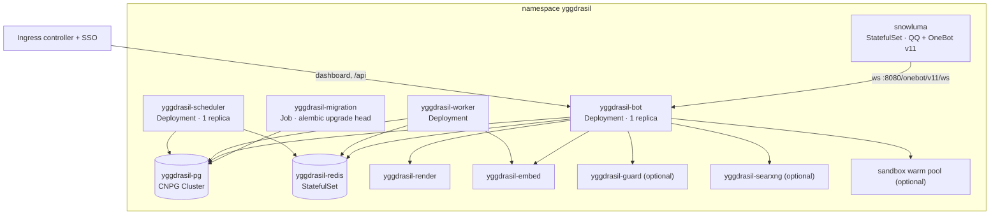

# Deploying YggdrasilBot

This guide installs YggdrasilBot on Kubernetes from the manifests in [`example/`](example). It is the same
layout the project runs in production, with names, domains and accounts replaced by placeholders
(`example.com`, QQ `10001`, `admin@example.com`). Read it once end to end before you start: a few choices,
such as the QQ device identity and the secret key, are expensive to change later.

- [1. What gets deployed](#1-what-gets-deployed)
- [2. Before you start](#2-before-you-start)
- [3. Images](#3-images)
- [4. Install, step by step](#4-install-step-by-step)
- [5. First-run configuration in the dashboard](#5-first-run-configuration-in-the-dashboard)
- [6. Configuration reference](#6-configuration-reference)
- [7. Operations](#7-operations)
- [8. Security model](#8-security-model)
- [9. Sandbox workspaces (optional)](#9-sandbox-workspaces-optional)
- [10. Troubleshooting](#10-troubleshooting)

## 1. What gets deployed



| File | Kind | Role | Needed |
|---|---|---|---|
| `namespace.yaml` | Namespace | | yes |
| `config.yaml` | ConfigMap `yggdrasil-config` | deployment settings shared by every role | yes |
| `secret.example.yaml` | Secret template (not applied) | access token, encryption key | yes, created by you |
| `postgres.yaml` | CNPG `Cluster` | PostgreSQL 18 + `pg_search` + `pgvector` | yes |
| `redis.yaml` | StatefulSet + Service | queues, rate limits, live config, sandbox state | yes |
| `migration.yaml` | Job | schema migrations before each release | yes |
| `bot.yaml` | Deployment + Service + ServiceAccount | OneBot connection, agents, dashboard, `/api` | yes |
| `worker.yaml` | Deployment | memory pipelines, embeddings, maintenance | yes |
| `scheduler.yaml` | Deployment | cron for the worker | yes |
| `snowluma.yaml` | StatefulSet | the QQ client speaking OneBot v11 | yes (or your own OneBot endpoint) |
| `render.yaml` | Deployment + Service | `render_*` tools, browser fallback of `read_url` | recommended |
| `embed.yaml` | Deployment + Service + PVC | local embedding model for memory search | recommended (or a hosted API) |
| `guard.yaml` | Deployment + Service + PVC | Qwen3Guard moderation | optional |
| `searxng.yaml` | Deployment + Service + ConfigMap | self-hosted web search backend | optional |
| `networkpolicy.yaml` | NetworkPolicies | keep `/onebot`, SnowLuma and the browser isolated | recommended |
| `ingress.yaml` | Traefik Middleware + IngressRoute | SSO-protected dashboard | yes, adapt to your ingress |
| `sandbox/` | kustomize Component | Linux workspaces for the model (gVisor) | optional, see [§9](#9-sandbox-workspaces-optional) |

All manifests run as non-root with a read-only root filesystem, dropped capabilities and `RuntimeDefault`
seccomp, except SnowLuma, which must be privileged (see [§8](#8-security-model)).

### Sizing

Requests and limits as shipped; production serves a few active groups with these values:

| Workload | CPU request | Memory request / limit | Storage |
|---|---|---|---|
| bot | 200m | 512Mi / 2Gi | |
| worker | 200m | 512Mi / 2Gi | |
| scheduler | 20m | 128Mi / 512Mi | |
| snowluma | 300m | 768Mi / 3Gi | 14Gi (QQ data and media cache) |
| render | 200m | 1Gi / 3Gi | |
| embed | 500m (limit 4) | 1Gi / 4Gi | 3Gi (model cache) |
| postgres | 100m | 512Mi | 20Gi |
| redis | 50m | 64Mi / 256Mi | 1Gi |
| guard (optional) | 500m (limit 2) | 1Gi / 3Gi | 2Gi |
| sandbox, per warm pod (optional) | 100m (limit 2) | 256Mi / 4Gi | up to 7Gi ephemeral |

The core set requests about 1.6 CPU and 4.5Gi of memory. Embedding and moderation run on CPU; the limits keep
them from starving the node when a backlog is embedded.

## 2. Before you start

**Cluster.** A recent Kubernetes release on amd64 with a default StorageClass. The project runs on k3s;
nothing below is k3s-specific except where noted (Traefik, the Service CIDR for the sandbox relay).

**Operators and add-ons.**

| Component | Why | Notes |
|---|---|---|
| [CloudNativePG](https://cloudnative-pg.io) | runs `postgres.yaml` | Or bring any PostgreSQL 18 with ParadeDB's `pg_search` and `pgvector`; then drop `postgres.yaml` and provide a secret `yggdrasil-pg-app` with keys `host`, `port`, `user`, `password`, `dbname`. |
| An ingress controller | dashboard | The example uses Traefik `IngressRoute`s (k3s ships Traefik). |
| An SSO proxy | dashboard login | e.g. [oauth2-proxy](https://oauth2-proxy.github.io/oauth2-proxy/) behind a forward-auth middleware, returning `X-Auth-Request-Email`. The dashboard has no login of its own. |
| Argo CD (optional) | GitOps sync, migration hook ordering | Plain `kubectl apply -k` works too. |
| Sealed Secrets or another secret manager (optional) | keep secrets in Git | |
| agent-sandbox + gVisor (optional) | sandbox workspaces | [§9](#9-sandbox-workspaces-optional) |

**Accounts and endpoints.**

- **A QQ account for the bot.** Use a dedicated account. Third-party clients are against QQ's terms and
  accounts can be restricted; a stable device identity avoids repeated logins but does not remove the risk.
- **An LLM provider** with an OpenAI-compatible (`/v1/chat/completions`) or Anthropic-compatible
  (`/v1/messages`) API. Every chat-like task needs **tool calling**; vision-capable models get images directly.
  Background agents inside workspaces (`delegate`) need an Anthropic-format provider.
- **Optional:** an [Exa](https://exa.ai) API key or the bundled SearXNG for web search; Grafana + an
  OpenTelemetry collector for traces.

## 3. Images

CI builds three images from this repository. Release tags select what gets built, and one commit may carry
several tags:

| Git tag | Image | Contents |
|---|---|---|
| `vX.Y.Z` | `yggdrasil-bot:vX.Y.Z` | bot, worker, scheduler and migration (one image, different commands) |
| `sandbox-vX.Y.Z` | `yggdrasil-sandbox:vX.Y.Z` | workspace image: sandboxd, Python + IPython, Chromium, helpers |
| `render-vX.Y.Z` | `yggdrasil-render:vX.Y.Z` | render service: Chromium, markdown-it, Shiki, KaTeX, Mermaid |

Pushes to `main` publish only the bot's `sha-<short>` and `main` tags. The version in `pyproject.toml` stays
`0.0.0`; the git tag reaches the bot as `YGG_VERSION` (reported in telemetry and the API metadata).

To get images you can pull, either:

- **fork the repository** and push tags; CI publishes to `ghcr.io/<you>/yggdrasil-*`. GHCR packages start
  private: make them public, or create an image pull secret and add it to the pods, e.g. with a kustomize patch
  adding `imagePullSecrets` to every workload; or
- **build locally**: `docker build -t <registry>/yggdrasil-bot:v0.1.0 .`, `docker build render` and
  `docker build sandbox` (the default target is the workspace image), then push to your registry.

Set the image names and tags in `example/kustomization.yaml` (`images:`).

## 4. Install, step by step

### 4.1 Copy the example

```sh
cp -r deploy/example ~/gitops/apps/yggdrasil    # or wherever your manifests live
cd ~/gitops/apps/yggdrasil
```

Edit these before the first apply:

| File | What to set |
|---|---|
| `kustomization.yaml` | image names and tags; enable `guard.yaml`, `searxng.yaml` or the `sandbox` component if wanted |
| `config.yaml` | `YGG_SUPERUSERS` (your QQ number), `YGG_ADMIN_EMAILS` (your SSO email), `TZ`, optional telemetry |
| `ingress.yaml` | the dashboard host and your SSO proxy's forward-auth address; TLS |
| `snowluma.yaml` | `QQ_ACCOUNT`, and a device identity you keep forever: `MACHINE_ID` (`openssl rand -hex 16`), the MAC address in `net-identity`, `HOST_NAME` |
| `postgres.yaml` | storage size and class; backups ([§7.4](#74-backups)) |
| `networkpolicy.yaml` | the ingress controller's namespace and labels if it is not k3s' Traefik |

> [!IMPORTANT]
> The device identity in `snowluma.yaml` (MAC address, machine-id, hostname) must stay the same for the life
> of the account. Changing any of it makes QQ treat the pod as a new device, which forces a new QR login and
> draws more risk-control attention. Do not reuse values from examples or other deployments.

### 4.2 Install the operators

Install CloudNativePG (and the ingress controller, SSO proxy, Argo CD if you use them) following their own
documentation. Check that the CRDs exist:

```sh
kubectl get crd clusters.postgresql.cnpg.io ingressroutes.traefik.io middlewares.traefik.io
```

### 4.3 Create the secret

Two values are required. Generate them once and store them somewhere safe:

```sh
kubectl create namespace yggdrasil
kubectl -n yggdrasil create secret generic yggdrasil-secrets \
  --from-literal=ONEBOT_ACCESS_TOKEN="$(openssl rand -hex 32)" \
  --from-literal=YGG_SECRET_KEY="$(python3 -c 'from cryptography.fernet import Fernet; print(Fernet.generate_key().decode())')"
```

- `ONEBOT_ACCESS_TOKEN` authenticates SnowLuma's connection to the bot. `snowluma.yaml` copies it into
  SnowLuma's config on every start.
- `YGG_SECRET_KEY` encrypts provider API keys in the database. **Back it up.** If it is lost or changed, every
  stored API key becomes unreadable and has to be entered again.
- Add `SEARXNG_SECRET` for `searxng.yaml` and `YGG_SANDBOX_TOKEN` for the sandbox
  ([`secret.example.yaml`](example/secret.example.yaml) lists them).

With Sealed Secrets: fill in `secret.example.yaml`, pipe it through `kubeseal`, and commit the sealed result
instead.

### 4.4 Apply

**Argo CD.** Point an Application at the directory. Sync waves order the rollout: namespace `-1`, data `0`, the
migration hook `1`, workloads `2`. The migration Job is a `Sync` hook, so every sync (every release) migrates
before the workloads change.

```yaml
apiVersion: argoproj.io/v1alpha1
kind: Application
metadata:
  name: yggdrasil
  namespace: argocd
spec:
  project: default
  source:
    repoURL: https://github.com/<you>/<gitops-repo>
    targetRevision: main
    path: apps/yggdrasil
  destination:
    server: https://kubernetes.default.svc
    namespace: yggdrasil
  syncPolicy:
    automated: { prune: true, selfHeal: true }
```

**kubectl.** Apply everything; the workloads restart until Postgres is up and the migration Job has finished
(the bot and worker wait up to 5 minutes at startup before giving up):

```sh
kubectl apply -k .
kubectl -n yggdrasil wait --for=condition=complete job/yggdrasil-migration --timeout=10m
kubectl -n yggdrasil get pods
```

Jobs are immutable: before applying a new image tag, delete the finished Job
(`kubectl -n yggdrasil delete job yggdrasil-migration`) so the new one runs.

### 4.5 Log in to QQ

SnowLuma shows the QQ login screen over noVNC. Nothing in the cluster can reach it; use a port-forward:

```sh
kubectl -n yggdrasil port-forward pod/snowluma-0 6081
# open http://127.0.0.1:6081 and scan the QR code with the bot account's phone
```

After login SnowLuma connects to `ws://yggdrasil-bot.yggdrasil.svc.cluster.local:8080/onebot/v11/ws`; the bot
log (`kubectl -n yggdrasil logs deploy/yggdrasil-bot`) shows the bot account connecting. The login survives
restarts as long as the volumes and the device identity stay the same.

SnowLuma's WebUI (port 5099) listens on loopback only. Its OneBot settings are rewritten on every start, so
change them in `snowluma.yaml`, not in the WebUI.

### 4.6 Open the dashboard

Browse to the host from `ingress.yaml`, sign in through your SSO proxy with an email listed in
`YGG_ADMIN_EMAILS`, and continue with [§5](#5-first-run-configuration-in-the-dashboard).

## 5. First-run configuration in the dashboard

Everything that changes at runtime lives in the database and takes effect immediately in every process.

1. **Providers.** Add each model endpoint: base URL (including `/v1`), API format (OpenAI or Anthropic), API
   key (stored encrypted). The model list is fetched from the provider; capabilities (vision, tool calling,
   context size) are looked up on models.dev, with aliases for names a gateway rewrites. Add the local services
   too:
   - embeddings: OpenAI format, `http://yggdrasil-embed:8080/v1`, model `qwen3-embedding-0.6b-q8`;
   - moderation (if deployed): OpenAI format, `http://yggdrasil-guard:8080/v1`, model `qwen3guard-gen-0.6b`.
2. **Models.** Map each task to a provider and model, with an optional fallback model:

   | Task | Used for | Model needs |
   |---|---|---|
   | `chat` | answering in groups (the main agent) | strong, tool calling; vision recommended |
   | `tldr` | summaries of messages, links, files, forwards | tool calling |
   | `vision` | describing images for models that can't see | vision |
   | `ops` | the superuser's natural-language admin agent | tool calling |
   | `quick_ack` | short notices in the persona's voice | cheap |
   | `memory_topic`, `memory_glossary`, `memory_profile`, `memory_digest` | background memory pipelines | tool calling (structured output); a fast, cheap model is fine |
   | `moderation` | input/output checks | the guard model |
   | `embedding` | memory vectors | an embedding model |
   | `rerank` | optional reranking of search hits | a reranker |
   | `agent` | background agents in workspaces | Anthropic-format provider |

   Then create an **embedding space** for the embedding model and activate it. The worker embeds the stored
   memory into it; switching spaces later re-embeds everything in the background.
3. **Search.** Add web search providers: Exa (API key, monthly quota) and/or SearXNG
   (`http://yggdrasil-searxng:8080`).
4. **Groups.** The bot only acts in enabled groups. Enable one, then adjust its settings: persona, reply style,
   rate limits, memory thresholds, enabled tools. Unset keys inherit the global settings.
5. **Triggers.** The defaults: @mention, reply to the bot, or the bot's name starts a chat; `tldr` / `太长不看`
   / `总结一下` (as a reply) starts a summary; `不要记我` / `记得我` / `忘记我` with an @mention handle privacy;
   superusers' private messages go to the ops agent. The trigger tester shows which rule a sample message
   matches.
6. **Try it.** @-mention the bot in the group. The Invocations page shows each run with its tool calls, token
   usage, latency and (with telemetry) a link to the trace.

## 6. Configuration reference

Environment variables (`yggdrasil/config.py` has the authoritative list):

| Variable | Default | Meaning |
|---|---|---|
| `POSTGRES_HOST`, `POSTGRES_PORT`, `POSTGRES_USER`, `POSTGRES_PASSWORD`, `POSTGRES_DB` | local `ygg` | database; the example reads them from the CNPG secret |
| `POSTGRES_POOL_SIZE` | `10` | connections per process |
| `REDIS_URL` | `redis://127.0.0.1:6379/0` | Redis |
| `YGG_SECRET_KEY` | required | Fernet key encrypting provider API keys |
| `ONEBOT_ACCESS_TOKEN` | empty | shared with the OneBot endpoint |
| `YGG_SUPERUSERS` | `[]` | JSON list of QQ numbers with admin rights (bootstrap; more in the dashboard) |
| `YGG_ADMIN_EMAILS` | `[]` | JSON list of dashboard admins (bootstrap; more in the dashboard) |
| `YGG_AUTH_EMAIL_HEADER` | `X-Auth-Request-Email` | header the SSO proxy sets with the user's email |
| `YGG_ENV` | `dev` | `prod` or `dev`; `dev` enables `YGG_DEV_ADMIN_EMAIL` |
| `YGG_DEV_ADMIN_EMAIL` | unset | dev only: requests without the auth header act as this admin |
| `YGG_HOST`, `YGG_PORT` | `0.0.0.0`, `8080` | bot listen address |
| `YGG_RENDER_URL` | unset | render service; the `render_*` tools are unavailable without it |
| `YGG_BROWSER_WS_URL` | unset | Playwright endpoint for `read_url`'s browser fallback |
| `YGG_LLM_USER_AGENT` | `yggdrasil-bot/0.1` | User-Agent for LLM requests (some gateways reject SDK defaults) |
| `YGG_GRAFANA_URL` | unset | links invocations to traces in Grafana |
| `OTEL_EXPORTER_OTLP_ENDPOINT`, `OTEL_SERVICE_NAME`, `OTEL_RESOURCE_ATTRIBUTES` | unset | OpenTelemetry over OTLP/HTTP; telemetry is off without an endpoint |
| `LOG_LEVEL`, `LOG_JSON` | `INFO`, `false` | logging |
| `TZ` | container default | local time for digests and timestamps |
| `YGG_SANDBOX_TOKEN` | unset | sandboxd bearer token; the sandbox is off without it |
| `YGG_SANDBOX_NAMESPACE`, `YGG_SANDBOX_WARMPOOL` | `yggdrasil`, `yggdrasil-sandbox` | where workspaces are claimed from |
| `YGG_SANDBOX_LINK_DOMAIN` | unset | wildcard domain for public links; publishing is off without it |
| `YGG_RELAY_URL` | unset | base URL workspaces reach the LLM relay at; `delegate` is off without it |
| `YGG_RELAY_PORT` | `8090` | port the bot serves the relay on |

Processes (one image, `ghcr.io/<you>/yggdrasil-bot`):

| Role | Command | Replicas |
|---|---|---|
| bot (default) | `python -m yggdrasil` | exactly 1: it owns the OneBot connection |
| worker | `taskiq worker yggdrasil.worker.broker:broker yggdrasil.worker.tasks` | 1 or more; each scheduled job locks per group |
| scheduler | `taskiq scheduler yggdrasil.worker.broker:scheduler yggdrasil.worker.tasks` | exactly 1 |
| migration | `alembic upgrade head` | Job |

Bot endpoints on port 8080: `/onebot/v11/ws` (OneBot; never expose it), `/` (dashboard), `/api`, `/healthz`
(liveness), `/readyz` (Postgres reachable), `/drainz?max_wait=N` (preStop: holds the pod until in-flight
replies are sent).

## 7. Operations

### 7.1 Upgrades

Change the tag in `kustomization.yaml` (or let a tool do it) and sync. With Argo CD the migration hook runs
first; the bot rolls without dropping replies: the new pod becomes ready without the OneBot connection, the old
one drains in `preStop`, SnowLuma reconnects to the new pod within seconds, and the new pod backfills the
messages of that gap.

To follow releases automatically, [argocd-image-updater](https://argocd-image-updater.readthedocs.io) can track
each image's newest `vX.Y.Z`:

```yaml
apiVersion: argocd-image-updater.argoproj.io/v1alpha1
kind: ImageUpdater
metadata:
  name: yggdrasil
  namespace: argocd
spec:
  applicationRefs:
    - namePattern: yggdrasil
      images:
        - alias: bot
          imageName: ghcr.io/<you>/yggdrasil-bot
          manifestTargets:
            kustomize:
              name: yggdrasil-bot          # the name in kustomization.yaml `images:`
          commonUpdateSettings:
            updateStrategy: semver
            allowTags: "regexp:^v\\d+\\.\\d+\\.\\d+$"
        # same for yggdrasil-render and yggdrasil-sandbox
```

After a **sandbox image** update, also recycle the workspaces ([§9](#9-sandbox-workspaces-optional)).

### 7.2 Rollback

- **Image:** pin the previous tag. With an image updater, also delete the bad tag from the registry, or the
  updater moves forward again.
- **Schema:** migrations only run forward. If the older image can't run against the new schema, run
  `alembic downgrade <revision>` from the new image first, then roll the image back.
- **Data:** restore Postgres from backup ([§7.4](#74-backups)).

### 7.3 Monitoring

- **Health:** the probes in the manifests cover startup, liveness and readiness. A cold start waits for
  Postgres and Redis for up to 5 minutes before failing.
- **Telemetry:** set `OTEL_EXPORTER_OTLP_ENDPOINT` in `config.yaml` to export traces (agent runs, model calls,
  tool calls, OneBot API calls), metrics (`ygg.*`: invocations, tool calls and latency, token usage, memory lag,
  review queue, sandbox workspaces) and logs. With `YGG_GRAFANA_URL`, the dashboard links every invocation to
  its trace.
- **Logs:** `LOG_JSON=true` writes structured JSON to stdout for Loki or similar.

### 7.4 Backups

Back up two things:

1. **`YGG_SECRET_KEY`**, outside the cluster.
2. **Postgres.** Messages, memory and all configuration live there. With CNPG, add the
   [Barman Cloud plugin](https://cloudnative-pg.io/plugin-barman-cloud/) for WAL archiving and base backups to
   S3-compatible storage, and a daily `ScheduledBackup`:

   ```yaml
   # in the Cluster spec
   plugins:
     - name: barman-cloud.cloudnative-pg.io
       isWALArchiver: true
       parameters:
         barmanObjectName: yggdrasil-pg-backup
   ---
   apiVersion: barmancloud.cnpg.io/v1
   kind: ObjectStore
   metadata:
     name: yggdrasil-pg-backup
   spec:
     retentionPolicy: "14d"
     configuration:
       destinationPath: s3://<bucket>/cnpg/
       endpointURL: https://<s3-endpoint>
       s3Credentials:
         accessKeyId: { name: yggdrasil-pg-s3, key: ACCESS_KEY_ID }
         secretAccessKey: { name: yggdrasil-pg-s3, key: ACCESS_SECRET_KEY }
       wal:
         compression: zstd
   ---
   apiVersion: postgresql.cnpg.io/v1
   kind: ScheduledBackup
   metadata:
     name: yggdrasil-pg-daily
   spec:
     schedule: "0 0 3 * * *"
     backupOwnerReference: self
     cluster:
       name: yggdrasil-pg
     method: plugin
     pluginConfiguration:
       name: barman-cloud.cloudnative-pg.io
   ```

Redis holds queues, counters and workspace state; losing it costs in-flight jobs, not data. SnowLuma's volumes
are not worth backing up: losing them means a new QR login.

## 8. Security model

- **Dashboard authentication is delegated.** The bot trusts the email header from your SSO proxy and checks it
  against the admin list. Anything that can reach port 8080 directly could forge that header, which is why the
  bot's NetworkPolicy only admits the ingress controller and SnowLuma, and the public route excludes
  `/onebot`.
- **Secrets.** Provider keys are encrypted at rest with `YGG_SECRET_KEY` and never shown back in full. Agents
  in workspaces never see a provider key: the relay issues per-job tokens with a model allowlist and a token
  budget.
- **SnowLuma is privileged.** It injects its hook into QQ with ptrace and adjusts the pod's identity with
  bind mounts. Keep it isolated: no inbound traffic (NetworkPolicy), its WebUI on loopback only, access by
  port-forward.
- **Untrusted content.** Web pages, files and chat messages are treated as data: they are fenced in prompts,
  fetched through an SSRF guard, and pages that need a real browser are opened in the render pod, which may only
  reach the public internet. Workspaces run under gVisor with their own egress policy and no cluster DNS.
- **Who can do what.** Action tools (recalling messages, admin operations) are only given to a run after the
  code has checked the speaker's role. Moderation (optional) can hold replies for review.

## 9. Sandbox workspaces (optional)

The sandbox gives the chat model persistent Linux workspaces, one per topic. Each group has up to 3 named
workspaces and the deployment at most 8 workspace pods (tool settings `sandbox_max_workspaces_per_group`,
`sandbox_max_workspaces`). A workspace is reclaimed after 30 minutes idle or 4 hours in total (tool settings;
running background jobs extend it), and its files go with it.

**1. gVisor on the nodes.** Install `runsc` and `containerd-shim-runsc-v1`, register the `runsc` runtime with
containerd (on k3s with a drop-in under `/var/lib/rancher/k3s/agent/etc/containerd/config-v3.toml.d/`), and
create the RuntimeClass:

```yaml
apiVersion: node.k8s.io/v1
kind: RuntimeClass
metadata:
  name: gvisor
handler: runsc
```

**2. agent-sandbox.** Install [kubernetes-sigs/agent-sandbox](https://github.com/kubernetes-sigs/agent-sandbox)
v1.0.7 with extensions (the `sandbox-with-extensions.yaml` release asset).

**3. Token.** Generate a token, add it to the secret, and put its digest into `sandbox/sandbox.yaml`:

```sh
TOKEN="$(openssl rand -hex 32)"
kubectl -n yggdrasil patch secret yggdrasil-secrets --type merge -p "{\"stringData\":{\"YGG_SANDBOX_TOKEN\":\"$TOKEN\"}}"
printf %s "$TOKEN" | sha256sum    # -> --auth-token-sha256=<digest>
```

**4. Network.** In `sandbox/sandbox.yaml`, replace the placeholder `203.0.113.10/32` with your nodes' public
IPs (workspaces must not reach your own services through the public address). In `sandbox/relay.yaml` and
`sandbox/kustomization.yaml`, pick a free ClusterIP in your Service CIDR for the LLM relay; workspaces use
public DNS and reach the relay by IP.

**5. Public links (optional).** Workspaces can publish a port as `https://<random id>.<domain>`. Point a
wildcard DNS record `*.<domain>` at your ingress, add a matching wildcard certificate, and set
`YGG_SANDBOX_LINK_DOMAIN` (in `sandbox/kustomization.yaml`). Use a domain that hosts nothing else: pages
served from workspaces are untrusted. The bot creates a Service and an IngressRoute per link (RBAC in
`sandbox/rbac.yaml`); drop `YGG_SANDBOX_LINK_DOMAIN` to disable publishing.

**6. Enable.** Uncomment `components: [sandbox]` in `kustomization.yaml` and sync. In the dashboard, map the
`agent` model route (needed for `delegate`) and enable the sandbox tools in the tool settings; the global
`tools.sandbox_enabled` switch turns the feature off everywhere.

**Background jobs.** `background` runs long shell commands and `delegate` hands multi-step tasks to an inner
coding agent in the workspace. Job state lives in Redis and under `/workspace/.ygg/jobs/`, so jobs continue
across bot restarts; when one finishes, the bot replies to the requester with the result. Limits (concurrent
jobs, run time, relay token budgets) are tool settings; the Sandbox page lists workspaces and jobs, shows job
events and usage, and can cancel jobs or destroy workspaces.

> [!NOTE]
> agent-sandbox v1.0.7 does not replace warm pods when the SandboxTemplate changes. After a new sandbox image
> or template change, destroy the workspaces on the dashboard's Sandbox page, then delete the warm pool's
> `Sandbox` objects (`kubectl -n yggdrasil get sandboxes`) so they are recreated from the new template.

## 10. Troubleshooting

| Symptom | Likely cause | Check |
|---|---|---|
| The bot never answers | group not enabled; OneBot not connected; token mismatch | dashboard Groups page; bot log for the OneBot connection; SnowLuma log for rejected WebSocket connections |
| Dashboard says 未登录 (401) | the SSO proxy doesn't forward the email header | `authResponseHeaders` in `ingress.yaml`; `YGG_AUTH_EMAIL_HEADER` |
| Dashboard says … 不是管理员 (403) | the email is not an admin | `YGG_ADMIN_EMAILS`, or add the admin from an existing admin account |
| Pods crash-loop right after install | Postgres not ready or migrations not applied yet | `kubectl -n yggdrasil get cluster,job`; migration Job logs |
| Migration fails with `permission denied to create extension` | the database was created without `vector` / `pg_search` | `postInitApplicationSQL` in `postgres.yaml`, or create both extensions as a superuser |
| QQ asks for a QR login after every restart | device identity or SnowLuma volumes changed | the identity values in `snowluma.yaml`; PVCs still bound |
| `read_url` fails on JavaScript-heavy pages | render service not configured | `YGG_BROWSER_WS_URL`; render pod logs |
| History search finds nothing semantic | no active embedding space, or the worker is behind | dashboard Models page; worker logs; memory lag metric |
| `delegate` is not offered to the model | `agent` route or `YGG_RELAY_URL` missing | dashboard Models page; bot config |
| Workspaces keep an old image | warm pods are not recreated on template changes | the note in [§9](#9-sandbox-workspaces-optional) |
